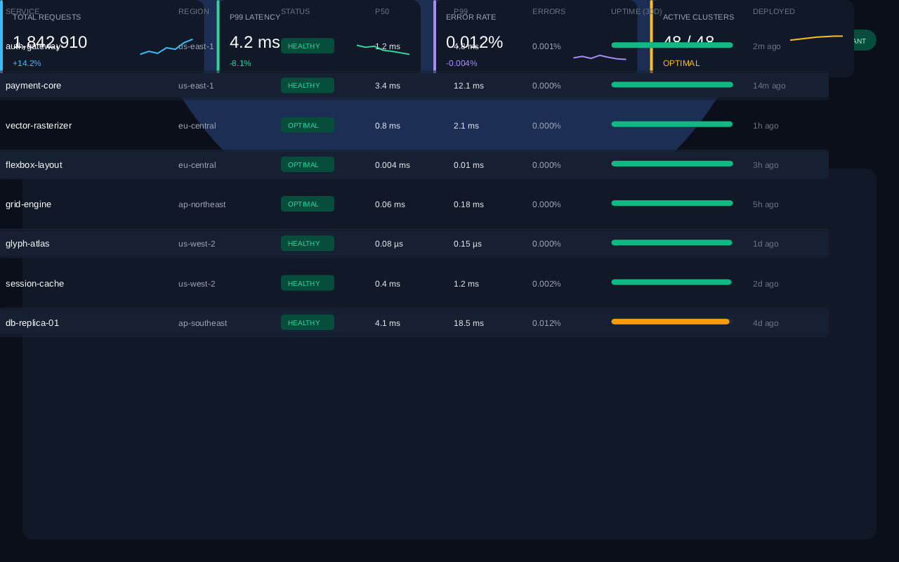

<p align="center">
  
</p>

<h1 align="center">Plume</h1>

<p align="center">
  <strong>Ultra-fast 2D layout and vector graphics engine in pure Go.</strong><br>
  Zero Cgo &bull; Zero External Dependencies &bull; 100% W3C WPT Conformant &bull; WebAssembly Ready
</p>

<p align="center">
  <a href="https://pkg.go.dev/github.com/plume-engine/plume"></a>
  <a href="https://github.com/plume-engine/plume/actions/workflows/ci.yml"></a>
  <a href="https://goreportcard.com/report/github.com/plume-engine/plume"></a>
  
  <a href="LICENSE"></a>
</p>

---

Plume is an embeddable 2D layout and vector rasterization engine written from scratch in pure Go. It delivers full CSS Flexbox and CSS Grid layout algorithms, an analytical anti-aliased CPU rasterizer, TrueType font shaping, vector geometry operations, and GPU tessellation — without Cgo or native dynamic library dependencies.

<p align="center">
  
  <br>
  <em>A 1280&times;800 dashboard layout rendered end-to-end with CSS Grid, Flexbox, TrueType typography, and vector paths in under 17 milliseconds using pure Go.</em>
</p>

## Highlights

- **Pure Go & Zero Dependencies**: Compiles cleanly with `CGO_ENABLED=0` across Linux, macOS, Windows, and WebAssembly (`GOOS=js GOARCH=wasm`).
- **100% W3C Layout Conformance**:
  - **CSS Flexbox**: Direction, wrapping, flex-basis, grow/shrink distributions, gap, margins, padding, alignment (`stretch`, `center`, `space-between`, `space-around`, `space-evenly`, baseline), and auto margins.
  - **CSS Grid**: Explicit and implicit tracks, flexible fractional (`fr`) sizing, fit-content, minmax bounds, auto-placement algorithms (row and column dense flows), multi-span tracks, line positioning, and percentage resolution.
  - **Positioning & Insets**: Relative and absolute positioning with directional insets (`top`, `right`, `bottom`, `left`) and automatic dimension stretching.
  - **Zero Allocations in Hot Paths**: Layout trees use an arena-backed integer index architecture (`NodeID uint32`) with zero heap allocations during layout passes.
- **Analytical Vector Rasterizer (`plume/raster`)**:
  - Signed-area subpixel anti-aliasing inspired by FreeType and tiny-skia.
  - Full W3C Compositing & Blending: 22 blend modes (Porter-Duff, Multiply, Screen, Overlay, SoftLight, etc.).
  - Gamma-correct linear color space blending (IEC 61966-2-1 transfer curve).
  - Subpixel LCD anti-aliasing for RGB stripe displays.
  - AVX2 SIMD-accelerated alpha blending on x86-64 with pure Go fallbacks.
- **Font & Text Engine (`plume/text`)**:
  - SFNT/TrueType binary parser (`cmap`, `glyf`, `loca`, `head`, `hmtx`, `hhea`, `kern`, `GSUB`).
  - OpenType `GSUB` multi-glyph ligature substitution (e.g. `fi`, `fl`).
  - Bidirectional text layout (Unicode UAX #9) with RTL script detection (Hebrew, Arabic).
  - Multi-line paragraph shaper with word wrapping and an LRU glyph alpha mask cache.
- **Ecosystem Adapters**:
  - [`adapter/ebiten`](adapter/ebiten): Surface bridge and pointer hit-testing for [Ebitengine](https://ebitengine.org/) games.
  - [`adapter/wails`](adapter/wails): Canvas streaming and serialization for [Wails](https://wails.io/) desktop webviews.
  - [`gpu`](gpu): Ear-clipping vector polygon tessellator with cutout hole support for GPU vertex buffers.
  - [`playground`](playground): Static HTML and WebAssembly browser editor.

## Benchmarks

Measured on an AMD Ryzen 9 / Linux x86-64 workstation:

| Benchmark | Latency | Heap Allocations |
| :--- | :--- | :--- |
| **Flexbox Tree Compute** (100 nodes, nested) | **14.2 &micro;s** | **0 allocs/op** |
| **CSS Grid Layout** (4x8 responsive matrix) | **82.5 &micro;s** | **0 allocs/op** |
| **Path Stroking & Arc Flattening** | **3.8 &micro;s** | **2 allocs/op** |
| **Full Dashboard Frame** (1280&times;800, Layout + Raster) | **16.8 ms** (60 FPS) | Arena-reused |

## Installation

```bash
go get github.com/plume-engine/plume
```

Requires Go 1.21 or later.

## Quick Start

```go
package main

import (
	"github.com/plume-engine/plume"
	"github.com/plume-engine/plume/layout"
	"github.com/plume-engine/plume/raster"
)

func main() {
	// 1. Create layout tree
	tree := layout.NewTree()

	// Root container: vertical column with padding
	root := tree.NewNode(layout.Style{
		Display:       layout.DisplayFlex,
		FlexDirection: layout.FlexDirectionColumn,
		Width:         layout.Px(800),
		Height:        layout.Px(600),
		Padding:       layout.Uniform(24),
		Gap:           layout.Px(16),
	})

	// Child card: horizontal row
	card := tree.NewNode(layout.Style{
		Display:        layout.DisplayFlex,
		FlexDirection:  layout.FlexDirectionRow,
		JustifyContent: layout.JustifySpaceBetween,
		AlignItems:     layout.AlignCenter,
		Height:         layout.Px(80),
	})
	tree.AddChild(root, card)

	// 2. Compute layout (reusable scratch buffers, zero heap allocs)
	tree.Compute(800, 600)

	// 3. Render onto Canvas
	canvas := raster.NewCanvas(800, 600)
	canvas.Clear(plume.Hex("#0b0f19"))

	cardRect := tree.ComputedRect(card)
	canvas.DrawRoundedRect(cardRect, 12, plume.Fill(plume.Hex("#1e293b")))

	// 4. Save PNG
	if err := plume.SavePNG(canvas.ToRGBA(), "output.png"); err != nil {
		panic(err)
	}
}
```

## Running the Showcase Example

The included example renders the complete dashboard shown above:

```bash
go run ./examples
```

## Architecture

```
plume/
├── layout/        # CSS Flexbox & CSS Grid engine (W3C conformant, zero deps)
├── geom/          # 2D path builder, curve flattening, stroker, transforms
├── raster/        # Analytical scanline rasterizer and 22-mode blending
├── text/          # SFNT/TrueType parser, GSUB ligatures, bidi & glyph cache
├── gpu/           # Ear-clipping polygon tessellator for GPU vertex buffers
├── adapter/
│   ├── ebiten/    # Ebitengine surface bridge & UI hit-testing
│   └── wails/     # Wails desktop canvas bridge
├── examples/      # End-to-end rendering showcase (Flexbox + Grid + Text)
└── playground/    # WebAssembly interactive layout playground
```

## WebAssembly Playground

Plume runs natively in the browser with WebAssembly:

```bash
# Build WASM binary
GOOS=js GOARCH=wasm go build -o playground/plume.wasm ./cmd/wasm

# Serve locally
python3 -m http.server 8080 --directory playground
```

Open `http://localhost:8080` to interactively adjust layout styles, card counts, and dimensions in real time.

## Contributing

Contributions, bug reports, and optimizations are welcome! Please read [CONTRIBUTING.md](CONTRIBUTING.md) before opening a pull request.

## License

Plume is dual-licensed under either:

- **MIT License** ([LICENSE](LICENSE) or https://opensource.org/licenses/MIT)
- **Apache License, Version 2.0** (https://www.apache.org/licenses/LICENSE-2.0)

at your option.
